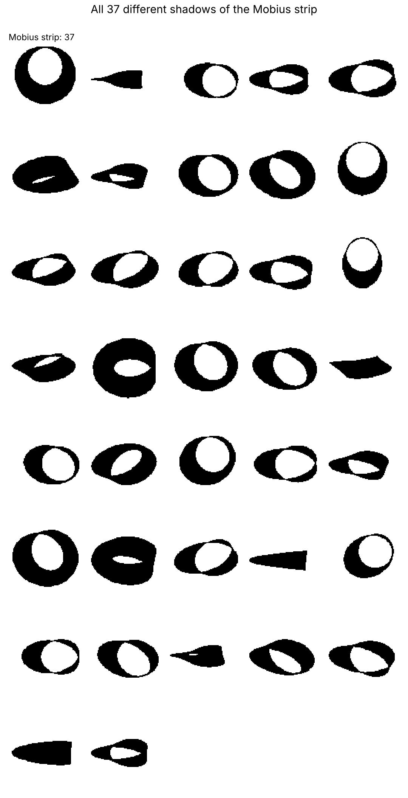
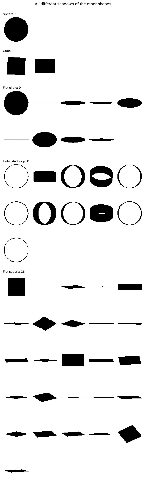
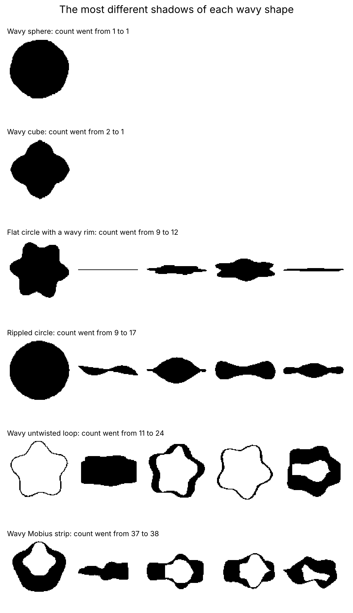
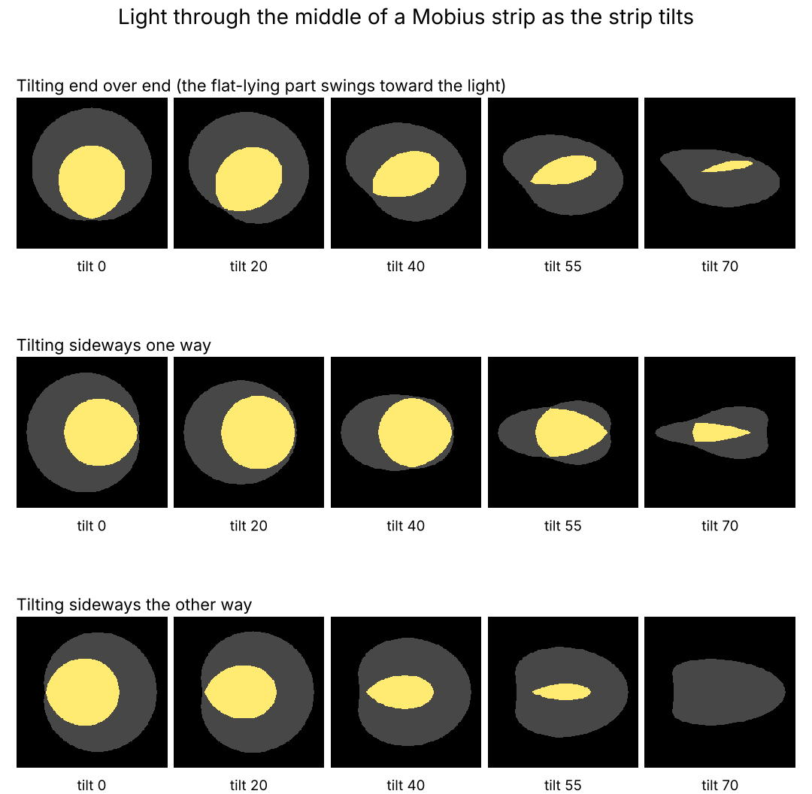

# Shadow test: how many different shadows does a Mobius strip cast compared with a circle and a square and a cube?

> **About this page:** An AI chatbot (Claude) ran these computer tests and wrote this page on 25 November 2026. No other person has rerun the tests which means every number on this page is unconfirmed.

## The question being tested

The author of this repository noticed that a Mobius strip seems to cast far more different shadows than a sphere or a cube because a Mobius strip can be turned and tilted into many poses that each look new. The author asked for a comparison of a flat circle and a flat square and a Mobius strip and later asked what happens when each shape is made wavy and what shape the light takes when light shines through the opening in the middle of a Mobius strip.

## How the test worked

A program shone straight light like sunlight on each shape from 2000 directions spread evenly around the shape and drew the shadow for each direction. Every shadow was scaled to the same size. Two shadows counted as the same shadow when one could be turned or mirror flipped to cover the other with a miss of 25 parts in 100 or less. The program then picked shadows one at a time and each pick was the shadow least like every shadow already picked. The count for a shape is the number of picks made before no remaining shadow missed by more than 25 parts in 100.

## Result 1: the Mobius strip cast the most different shadows

| Shape | Different shadows |
|---|---|
| Sphere | 1 |
| Cube | 2 |
| Lumpy rock with no dents | 5 |
| Flat circle | 9 |
| Untwisted loop | 11 |
| Flat square | 26 |
| Mobius strip | 37 |

The ranking stayed the same at a stricter setting of 15 parts in 100 and at a looser setting of 35 parts in 100. The Mobius strip count barely moved when the number of light directions was cut in half because the count was 36 with 1000 directions and 37 with 2000 directions.

The cube scored low because every shadow of a cube is a fat block or a fat six-sided shape. The flat square scored high because a tilted square makes long thin slanted shapes that look very different from a square.

## Result 2: every shadow of a flat shape is one shadow stretched

Every shadow of a flat circle is an oval and every shadow of a flat square is a slanted four-sided shape. Mathematics guarantees both facts because straight light turns a flat shape into a stretched and slanted copy of the same flat shape. A second count therefore stretched every shadow to an even spread before comparing so that stretched copies of one shadow count as one shadow.

| Shape | Different shadows after stretching is removed |
|---|---|
| Sphere | 1 |
| Flat circle | 1 |
| Flat square | 1 |
| Cube | 2 |
| Lumpy rock with no dents | 3 |
| Untwisted loop | 16 |
| Mobius strip | 37 |

The Mobius strip kept all 37 shadows because the shadows of a Mobius strip differ in kind and are not stretched copies of one shadow. Some shadows are a thick ring with a round opening and some are a lopsided teardrop with a slit and some are a solid wedge with no opening.

## Result 3: openings and dents

No shadow of the sphere or the flat circle or the flat square or the cube or the lumpy rock had an opening or a dent. Mathematics guarantees the result because a shape with no dents can never cast a dented shadow. About 73 out of 100 shadows of the Mobius strip had an opening and about 61 out of 100 had a dent. About 61 out of 100 shadows of the untwisted loop had an opening and about 50 out of 100 had a dent.

## Result 4: reshaping a flat shape adds no shadows and reshaping a Mobius strip adds many

A pool of 2000 shadows was split between a shape and reshaped copies of the shape.

- A flat circle pooled with a stretched flat circle gave 9 different shadows which is the same as the flat circle alone.
- A flat square pooled with a stretched flat square gave 26 different shadows which is the same as the flat square alone.
- An untwisted loop pooled with a stretched loop and a wider loop and a narrower loop gave 39 different shadows where the loop alone gave 11.
- A Mobius strip pooled with a stretched Mobius strip and a wider Mobius strip and a narrower Mobius strip gave 113 different shadows where the Mobius strip alone gave 37.

A watcher therefore cannot tell a stretched flat circle from a tilted flat circle by shadow while the shadow of a Mobius strip reports changes in the strip itself.

## Result 5: waves helped thin shapes and barely changed the Mobius strip

Each shape was given waves about 15 parts in 100 as tall as the shape is wide.

| Shape | Before waves | After waves | Before with stretching removed | After with stretching removed |
|---|---|---|---|---|
| Sphere | 1 | 1 | 1 | 1 |
| Cube | 2 | 1 | 2 | 1 |
| Flat circle given a wavy rim like a flower | 9 | 12 | 1 | 1 |
| Flat circle rippled up and down like a potato chip | 9 | 17 | 1 | 5 |
| Untwisted loop | 11 | 24 | 16 | 35 |
| Mobius strip | 37 | 38 | 37 | 29 |

- Waves on a fat shape hid inside the shadow because the shadow of a sphere or a cube is mostly filled area. A much stricter setting of 8 parts in 100 did see the waves on the sphere because the count went from 1 to 7 there.
- A flat circle with a wavy rim is still flat so the count with stretching removed stayed at 1.
- Rippling the circle up and down gave the circle depth and the count with stretching removed rose from 1 to 5.
- The untwisted loop gained the most. A smooth loop looks the same when turned around the middle and five waves broke that sameness.
- The Mobius strip gained almost nothing. One possible reason is that the half twist had already removed nearly all of the sameness so the waves had little left to break.

The wavy loop passed the wavy Mobius strip on the count with stretching removed. The shadow count could therefore track how little sameness a shape has from different sides more than the count tracks the half twist itself.

## Result 6: light through the middle of a Mobius strip

Straight light was shone through the opening in the middle of the Mobius strip and the lit patch on the wall was traced while the strip tilted away from face-on in twelve directions.

- Face-on the lit patch was a slightly egg-shaped round patch that sat off center because one side of the strip lies flat and covers more of the middle than the side that stands on edge.
- Tilting the strip end over end shrank the lit patch steadily. The patch kept 89 parts in 100 of the face-on area at a tilt of 20 degrees and 62 parts at 40 degrees and 27 parts at 60 degrees and 9 parts at 70 degrees. The patch turned from an egg into a slanted leaf shape with one flat side and then into a thin sliver.
- Tilting the strip sideways one way made the lit patch grow first. The patch reached 112 parts in 100 of the face-on area at a tilt of 20 degrees and stayed round up to 40 degrees and then turned into a teardrop with one point.
- Tilting the strip sideways the other way shrank the lit patch at once. The patch kept 76 parts in 100 at a tilt of 20 degrees and turned into a lemon shape with two points.
- The lit patch closed completely at a tilt between 70 degrees and 80 degrees and the closing tilt depended on the direction of the tilt.
- The lit patch never had a dent in any of the tested poses because the patch filled 98 parts in 100 or more of a rubber band stretched around the patch.
- The lit patch gained a sharp point wherever two different stretches of the edge of the strip crossed each other in the view.

An untwisted loop would give the same lit patch for every direction of tilt because an untwisted loop looks the same when turned around the middle. The lit patch of the Mobius strip depended on the direction of the tilt which means the lit patch alone tells a watcher which way the strip is leaning.

## What the results could mean for the ribbon picture

A count of different shadows is a count of messages because a shape with 37 different shadows can tell a watcher which of 37 poses the shape is in from one shadow. A sphere can tell the watcher nothing because every pose gives the same disk. Shapes with many different shadows could therefore have more capacity for carrying information to the surroundings which fits the parts of the main document that compare ribbon structures with proteins because a protein needs a lopsided shape with pockets to tell one partner from another.

Two cautions apply to the idea. A crumpled wad of paper would likely beat the Mobius strip on shadow count and a crumpled wad carries nothing useful so the count measures how many states can be told apart and does not measure whether the states are orderly. The count also measures one frozen shape seen from outside and does not measure what a strip could store inside such as a number of twists or a kind of knot.

One prediction could fail. A knotted band should score above the Mobius strip and a random crumpled strip should score highest of all if shadow count tracks lack of sameness. A knotted band scoring below the plain Mobius strip would be evidence against the idea.

## Limits of the tests

- The program compares shadows by how much the dark areas overlap so two very thin rings or two very thin slivers that differ by a hair get counted as different. The counts for the flat circle and the flat square and the untwisted loop are therefore more generous than a person looking at the pictures would give. The count with stretching removed does not have the weakness for flat shapes because stretching turns every sliver back into a full shape.
- The exact counts depend on the setting of 25 parts in 100. Counts a few apart such as 37 and 38 are best read as equal.
- The Mobius strip was the standard smooth textbook shape with a width of 0.8 against a loop radius of 1. A paper Mobius strip settles into a different shape and could give different counts.
- The light was straight like sunlight. A lamp close to the shape would enlarge the near parts of the shadow and could change the counts.
- Each wavy shape was tested at one wave height and one number of waves.
- Shadows were drawn on a grid of 48 by 48 squares for comparing and 160 by 160 squares for finding openings and dents.
- No search for published studies of shadow counts was made.

## How to rerun the tests

The programs sit in the folder named shadow-test inside the mobius-strip-calculations folder inside the boring-things folder of this repository. The page named README.md in that folder says what each program does.
