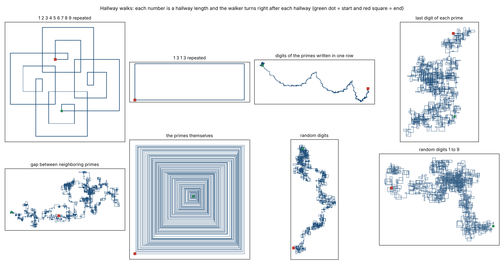

# Hallway walks: each number is the length of a hallway

> **About this page:** One AI model (Claude) wrote this page on 25 November 2026 from a back and forth chat with the author of this repository. The author proposed the rule: each number is the length of a hallway and the walker turns after every hallway and a hallway may cross an earlier hallway. The chatbot wrote the program and ran the counts. The counts are measurements from the program hallways.py in the folder boring-things/research-program-files/prime-mazes-scripts. No other person has reviewed the page yet.

## The rule

A walker starts facing north. For each number the walker walks that many steps in a straight hallway and then turns right. A hallway may cross an earlier hallway. Each test below used 2000 hallways except the test with the primes themselves which used 300.

## Results

- **1 2 3 4 5 6 7 8 9 repeated:** the walk stays inside a box of 17 by 17 steps and 98% of the steps land on a spot already visited because the pattern of hallways repeats every 36 hallways and nearly closes on itself.
- **1 3 1 3 repeated:** the walk is one rectangle of 1 by 3 steps traced 500 times because four hallways bring the walker back to the start.
- **Random digits:** the walk wanders with no steady direction because each hallway length is unrelated to the hallway before. Across 200 random walks the average distance from start to end was 120 steps and the largest was 319 steps.
- **Digits of the primes written in one row:** the walk ends 992 steps from the start and almost all of the distance is eastward (969 steps east). No random walk out of 200 drifted that far.
- **Last digit of each prime:** the walk ends 127 steps from the start which is ordinary for a random walk.
- **Gap between neighboring primes:** the walk ends 235 steps from the start inside a box of 540 by 278 steps.
- **The primes themselves:** the walk is a square spiral that never crosses itself because each hallway is longer than the hallway two turns earlier.

## Why the digits of the primes drift east

The drift is a resonance between primes with 4 digits and the 4 directions. Most of the first 2000 digits in the row belong to primes with 4 digits. A prime with 4 digits uses exactly four hallways which is one full turn. So the first digit of every such prime points the same way and the third digit of every such prime points the opposite way.

The first digit of the primes from 1009 to 1999 is always 1 while the third digit averages about 4.5. So every prime in that stretch pushes the walker about 3 or 4 steps in the direction of the third digit. A few hundred primes in a row add up to the drift of 969 steps.

The same resonance could show up for primes with 8 digits or 12 digits because those lengths are also full turns. Primes with 5 digits should break the resonance because each prime starts one quarter turn later than the prime before.

## What the two rules share

Under the hallway rule and under the door rule on the page [maze-test-findings.md](maze-test-findings.md) the patterns that stand out are caused by the way primes are written (the last digit is 1 or 3 or 7 or 9 and neighbors share leading digits) more than by anything hidden in which numbers are prime. Random-looking inputs such as half of the gap between primes give pictures that look like the pictures from random digits.
