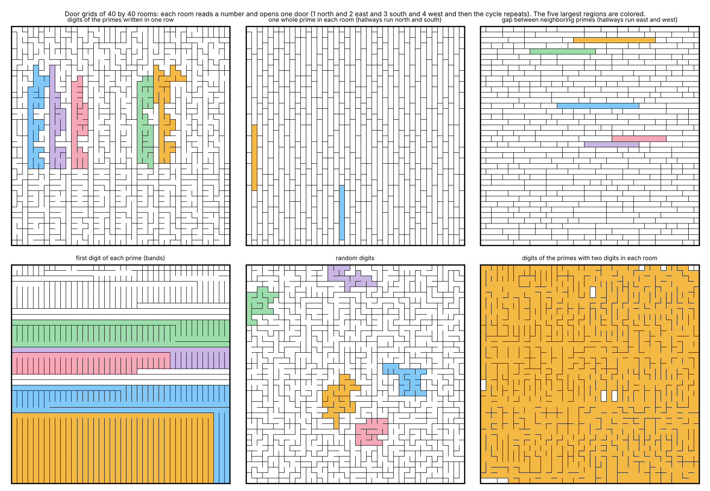
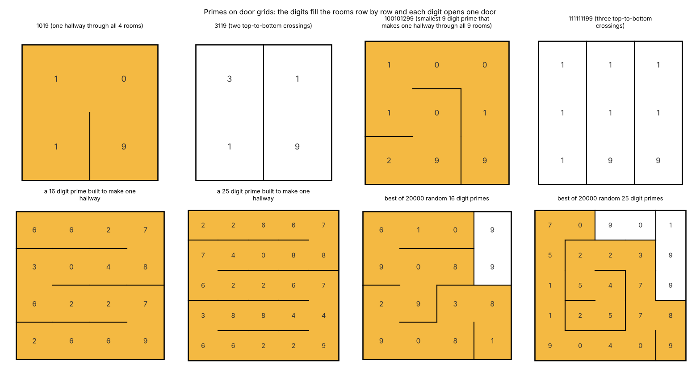

# The maze test: door grids made from the digits of primes

> **About this page:** One AI model (Claude) wrote this page on 25 November 2026 from a back and forth chat with the author of this repository. The author proposed the rule for the doors and the three scores and the idea of ranking primes by the scores. The chatbot wrote the programs and ran the counts. The counts are measurements from the programs in the folder boring-things/research-program-files/prime-mazes-scripts. A quick web search did not turn up this rule or these counts. The page proves nothing about primes. No other person has reviewed the page yet.

## The rule

Picture a square grid of rooms where every room starts with four closed doors. Each room reads one number and opens one door.

- The number 1 opens the north door and 2 opens the east door and 3 opens the south door and 4 opens the west door.
- The cycle then repeats so 5 is north and 6 is east and 7 is south and 8 is west and 9 is north and 0 is west.
- A door opened from either side joins the two rooms.
- A door that points outside the grid joins nothing.
- The numbers fill the rooms row by row starting at the top left room.

A prime with 4 digits fills a grid of 2 by 2 rooms exactly and a prime with 9 digits fills a grid of 3 by 3 rooms and a prime with 16 digits fills a grid of 4 by 4 rooms.

The program [maze-animation.html](maze-animation.html) shows the doors opening one room at a time for any of these inputs. The program runs in a web browser at this address: https://chmillera-hub.github.io/spare-token-bug-fixes/1-research-click-here-first/prime-mazes/maze-animation.html

## The scores

- A region is a group of rooms joined by open doors.
- A top to bottom crossing is a region that touches both the top row and the bottom row which means a walker can enter at the top and leave at the bottom.
- A side to side crossing is a region that touches both the left column and the right column.
- The longest walk is the most rooms a walker can visit without entering a room twice.
- A "full hallway" on this page means a longest walk that visits every room of the grid.
- The maze score is the longest walk plus the number of rooms along one side for each crossing. So each crossing is worth one full row of rooms.

## One fact that shapes every picture: odd numbers open north or south and even numbers open east or west

The numbers 1 and 3 and 5 and 7 and 9 open the north door or the south door while 2 and 4 and 6 and 8 and 0 open the east door or the west door. Three results follow from that one fact.

- A grid with one whole prime in each room has hallways that run north and south and no door between columns because every prime above 2 is odd.
- A grid fed by the gaps between neighboring primes has hallways that run east and west and no door between rows because every gap above the first gap is even.
- The last digit of a prime is 1 or 3 or 7 or 9 so the bottom right room of a prime grid always opens north or south.

## Every prime with 4 digits on a grid of 2 by 2 rooms

There are 1061 primes with 4 digits.

- 196 of the 1061 primes (18.5%) make a full hallway through all 4 rooms and the first ones are 1019 and 1021 and 1051 and 1061 and 1069 and 1091.
- 324 of the 1061 primes (30.5%) join the top left room to the bottom right room.
- 145 primes have two top to bottom crossings (such as 1151 and 3119) while 35 primes have two side to side crossings (such as 1063 and 1423).
- 70 primes open no door between rooms at all so the longest walk is 1 room.
- The maze scores are 8 for 196 primes and 7 for 254 primes and 6 for 180 primes and 4 for 361 primes and 1 for 70 primes.

For comparison 19.3% of all 9000 numbers with 4 digits make a full hallway and 32.8% join the two corners. So primes do slightly worse than plain numbers on both counts and the likely reason is the bottom right room which can never open a west door when the number is a prime.

## Every prime with 9 digits on a grid of 3 by 3 rooms

There are 45086079 primes with 9 digits and the program tested every one.

- 80279 primes (0.178%) make a full hallway through all 9 rooms. The smallest is 100101299 and the largest is 988988269.
- 4244233 primes (9.41%) join the top left room to the bottom right room.
- The average longest walk is 4.26 rooms.
- Longest walk of 2 rooms: 1888638 primes. 3 rooms: 10729356. 4 rooms: 15989540. 5 rooms: 9355883. 6 rooms: 5083192. 7 rooms: 1345788. 8 rooms: 613403. 9 rooms: 80279.
- Top to bottom crossings: 19881671 primes have none and 21988791 have one and 3154593 have two and 61024 have three.
- Side to side crossings: 26531722 primes have none and 17462655 have one and 1084397 have two and 7305 have three.
- 9919303 primes (22.0%) have a crossing in both directions.

### Primes against all numbers with 9 digits

The program also scored all 900 million numbers with 9 digits by weighting each door pattern.

- Full hallway: 0.178% of primes against 0.210% of all numbers.
- Corner to corner: 9.41% of primes against 11.05% of all numbers.
- At least one top to bottom crossing: 55.9% of primes against 50.0% of all numbers.
- At least one side to side crossing: 41.2% of primes against 50.0% of all numbers.

So a prime grid of 3 by 3 rooms leans toward top to bottom crossings and away from side to side crossings. The reason is the last digit: the bottom right room of a prime grid opens north half of the time (digits 1 and 9) and never opens west.

### The three kinds of high score

- The highest maze score any prime with 9 digits reached is 15 which is a full hallway (9 rooms) plus one crossing in each direction (3 + 3). All 80279 full hallway primes score 15.
- A prime with three top to bottom crossings scores 12 because the three hallways are 3 rooms long (3 + 3 × 3). The first ones are 111111199 and 111115919 and 111119551. Every digit of such a prime is odd because an even digit would open a door east or west.
- The full count for every score is in the file [ranking-list.txt](ranking-list.txt): 613403 primes score 14 and 1345788 score 13 and 3627635 score 12 and 5171615 score 11.

The two goals pull against each other when each room opens one door. A full hallway uses every room for one walk so the grid has one crossing each way. Three separate crossings need three separate hallways so the longest walk stops at 3 rooms.

## Larger grids: random primes with 16 to 400 digits

Each line reports random primes of the size that fills the grid. The second figure in each pair is for plain random numbers of the same length.

- 4 by 4 rooms (20000 primes with 16 digits): 3.2% join the corners (3.9% for plain numbers) and the average longest walk is 5.8 rooms and the best longest walk found is 14 rooms out of 16.
- 5 by 5 rooms (20000 primes with 25 digits): 1.3% join the corners (1.4%) and the average longest walk is 7.2 rooms and the best found is 19 out of 25.
- 6 by 6 rooms (8000 primes): 0.5% join the corners and the average longest walk is 8.4 rooms and the best found is 20 out of 36.
- 8 by 8 rooms (3000 primes): 0.03% join the corners and the average longest walk is 10.5 rooms and the best found is 25 out of 64.
- 10 by 10 rooms (2000 primes with 100 digits): none join the corners and the average longest walk is 12.2 rooms and the best found is 28 out of 100.
- 20 by 20 rooms (300 primes with 400 digits): none join the corners and no grid has a crossing and the average longest walk is 17.5 rooms.

Share of primes with at least one crossing:

- 4 by 4 rooms: 37.5% top to bottom and 28.5% side to side.
- 5 by 5 rooms: 24.2% top to bottom and 19.7% side to side.
- 6 by 6 rooms: 15.2% top to bottom and 12.3% side to side.
- 8 by 8 rooms: 4.4% top to bottom and 4.6% side to side.
- 10 by 10 rooms: 1.2% top to bottom and 1.5% side to side.

So a random prime makes a finishable maze less and less often as the grid grows. The lean toward top to bottom crossings fades by 8 by 8 rooms because the bottom right room is one room out of 64.

### Why large grids break into islands

With one door for each room about 44% of the inner walls end up open. A large random grid needs about half of the inner walls open before one region can stretch from one side to the other (a known result about random grids). So one door for each room lands just short of the level a crossable maze needs.

A grid of 300 by 300 rooms shows the result:

- Random digits: 44.0% of inner walls open and 11774 regions and the largest region has 63 rooms and no crossing exists.
- Digits of the primes written in one row: 44.9% of inner walls open and 9477 regions and the largest region has 512 rooms and the longest walk is 186 rooms. The north door opens in 39% of rooms because the small primes in the row hold many digits 1 and 9.
- One whole prime in each room: north 50% and south 50% and the longest hallway is 21 rooms.
- Gap between neighboring primes: east 57% and west 43% and the longest hallway is 19 rooms.
- First digit of each prime: 49.9% of inner walls open and the largest region has 10962 rooms and 106 regions cross from side to side. The cause is that thousands of neighboring primes share a first digit so whole rows of rooms open the same door and form bands.
- Half of the gap between neighboring primes: all four doors appear and the grid looks close to the random grid (the largest region has 66 rooms).

### Two numbers in each room make one crossable maze

When each room reads two numbers and opens two doors about 68% of the inner walls are open. On the grid of 300 by 300 rooms the digits of the primes then put 99.7% of the rooms in one region and the corners are joined and a walker can cross both ways. Three numbers in each room put every room but a handful in one region.

## Primes built on purpose to make one full hallway

A random prime with 100 digits almost never makes one hallway through all 100 rooms. A prime can be built to do so because each door direction can be written with two or three different digits. The program picked a snake path through the grid and then tried digit choices until the whole number was prime.

- 4 by 4 rooms: 6627304862272669
- 5 by 5 rooms: 2266774088622673884466229
- 6 by 6 rooms: 626663788808226227788884622223666623
- 8 by 8 rooms: 2226662730884040626226633080000862222627344808402222666726266269
- 10 by 10 rooms: 6222626627700440408426222626633880840480266622266370004804882666222627308480040462226222232266666621

Each of these primes passed 30 rounds of a random-witness primality check and makes a longest walk that visits every room.

## Weak points

- The counts for grids of 4 by 4 rooms and larger are from random samples so the "best found" lines are the best of the sample and not the best possible.
- The maze score is one choice among many and a different weight for crossings would reorder the ranking.
- The count of crossings counts separate regions. A single region with loops could hold two routes that never touch and the count treats that region as one crossing.
- The explanation that the bottom right room causes the gap between primes and plain numbers fits the counts and was not tested with a separate experiment.

## Ideas for a next test

- Give each room two digits and count routes that never share a room because grids with two doors in each room have loops and real choices.
- Score every prime with 16 digits in a narrow range to find the smallest prime with 16 digits that makes a full hallway.
- Feed the grid with other sequences (digits of pi or square roots) and compare the scores with the prime grids.

## Files

- [maze-animation.html](maze-animation.html) is the program that shows a grid being built one room at a time.
- [ranking-list.txt](ranking-list.txt) ranks all 1061 primes with 4 digits by maze score and gives the score counts for primes with 9 digits and the ten best primes found for larger grids.
- [hallway-walk-findings.md](hallway-walk-findings.md) covers a second rule where each number is the length of a hallway.
- The programs sit in boring-things/research-program-files/prime-mazes-scripts: door_grid.py (longest walks and corner to corner counts) and maze_test.py (crossings and maze scores and the grid of 300 by 300 rooms and the built primes) and ranking_list.py and draw_grids.py with grid_tools.py holding the shared parts.
