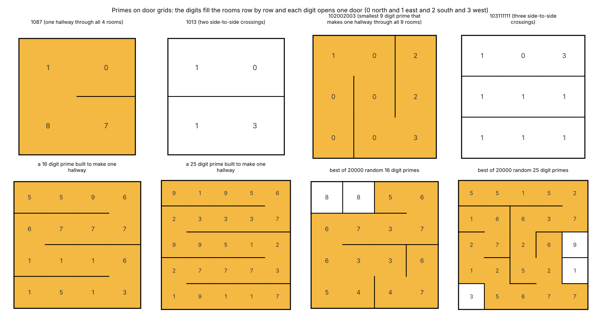
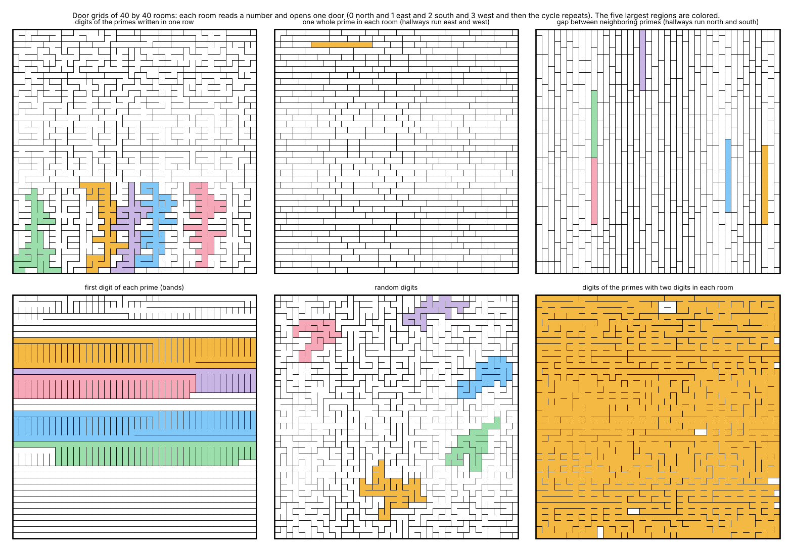

# The maze test with 0 as north: door grids made from the digits of primes

> **About this page:** One AI model (Claude) wrote this page on 25 November 2026 after the author of this repository asked whether 0 or 1 should open the north door. This page repeats every count from the page [maze-test-findings.md](maze-test-findings.md) under a second version of the door rule in which 0 opens north. The author proposed the rule and the chatbot wrote the programs and ran the counts. The counts are measurements from the programs in the folder boring-things/research-program-files/prime-mazes-scripts. The page proves nothing about primes. No other person has reviewed the page yet.

## The two versions of the rule

Each room reads one number and opens one door and the doors go clockwise in the order north then east then south then west.

- **First version (1 opens north):** 1 and 5 and 9 open north. 2 and 6 open east. 3 and 7 open south. 4 and 8 and 0 open west.
- **Second version (0 opens north) which this page uses:** 0 and 4 and 8 open north. 1 and 5 and 9 open east. 2 and 6 open south. 3 and 7 open west.

A short way to find the door under the second version is to divide the number by 4 and keep the remainder: remainder 0 is north and 1 is east and 2 is south and 3 is west.

Everything else is the same as on the first page. A door opened from either side joins the two rooms. A door that points outside the grid joins nothing. The numbers fill the rooms row by row starting at the top left room. The scores (regions and crossings and longest walk and maze score) are defined on the first page.

The program [maze-animation.html](maze-animation.html) has a box named "Door rule" that switches between the two versions. The program runs in a web browser at this address: https://chmillera-hub.github.io/spare-token-bug-fixes/1-research-click-here-first/prime-mazes/maze-animation.html

## The ranked list

The file [ranking-list-zero-north.txt](ranking-list-zero-north.txt) ranks all 1061 primes with 4 digits by maze score under the second version and gives the score counts for all primes with 9 digits and the ten best primes found for larger grids. The file [ranking-list.txt](ranking-list.txt) is the same list under the first version.

## What changed and what stayed the same

- **The lean of the primes flipped.** Under the first version 55.9% of primes with 9 digits have a top to bottom crossing and 41.2% have a side to side crossing. Under the second version 41.8% have a top to bottom crossing and 58.1% have a side to side crossing.
- **Odd and even swapped jobs.** Under the second version odd numbers open east or west and even numbers open north or south. So a grid with one whole prime in each room now has hallways that run east and west and a grid fed by the gaps between primes has hallways that run north and south.
- **Every champion prime changed.** The first prime with 4 digits that makes a full hallway is 1087 (it was 1019) and the smallest prime with 9 digits that makes a full hallway is 102002003 (it was 100101299).
- **Full hallways became a little more common.** 91720 primes with 9 digits make a full hallway against 80279 under the first version which is 14% more.
- **The highest score stayed at 15** for primes with 9 digits and the spread of scores kept the same shape.
- **Large grids still break into islands** because about 44% of the inner walls open under both versions.
- **Two numbers in each room still join almost every room** into one region.

So the counts depend on the choice of which number is north while the broad behavior does not. A pattern that shows up under both versions is more likely to say something about digits and doors and less likely to be an accident of the labels.

## Every prime with 4 digits on a grid of 2 by 2 rooms

There are 1061 primes with 4 digits.

- 211 of the 1061 primes (19.9%) make a full hallway through all 4 rooms and the first ones are 1087 and 1103 and 1187 and 1201 and 1213 and 1217.
- 354 of the 1061 primes (33.4%) join the top left room to the bottom right room.
- 178 primes have two side to side crossings (such as 1013 and 1019) while 27 primes have two top to bottom crossings (such as 2221 and 2239).
- 49 primes open no door between rooms at all so the longest walk is 1 room.
- The maze scores are 8 for 211 primes and 7 for 273 primes and 6 for 205 primes and 4 for 323 primes and 1 for 49 primes.

For comparison 19.6% of all 9000 numbers with 4 digits make a full hallway and 32.3% join the two corners. So primes do slightly better than plain numbers on both counts under the second version while primes did slightly worse under the first version.

## Every prime with 9 digits on a grid of 3 by 3 rooms

There are 45086079 primes with 9 digits and the program tested every one.

- 91720 primes (0.203%) make a full hallway through all 9 rooms. The smallest is 102002003 and the largest is 999994837.
- 4579178 primes (10.16%) join the top left room to the bottom right room.
- The average longest walk is 4.28 rooms.
- Longest walk of 2 rooms: 1757646 primes. 3 rooms: 10638791. 4 rooms: 15754190. 5 rooms: 9704493. 6 rooms: 5185237. 7 rooms: 1368945. 8 rooms: 585057. 9 rooms: 91720.
- Top to bottom crossings: 26222226 primes have none and 17772841 have one and 1084788 have two and 6224 have three.
- Side to side crossings: 18877285 primes have none and 22575761 have one and 3559532 have two and 73501 have three.
- 10280296 primes (22.8%) have a crossing in both directions.

### Primes against all numbers with 9 digits

- Full hallway: 0.203% of primes against 0.214% of all numbers.
- Corner to corner: 10.16% of primes against 10.09% of all numbers.
- At least one top to bottom crossing: 41.8% of primes against 50.0% of all numbers.
- At least one side to side crossing: 58.1% of primes against 50.3% of all numbers.

So a prime grid of 3 by 3 rooms leans toward side to side crossings under the second version. The likely reason is the last digit again. The bottom right room of a prime grid reads 1 or 3 or 7 or 9. Under the second version 3 and 7 open west into the room on the left while 1 and 9 open east onto the outer wall so the bottom right room never opens north. That reason fits the counts and was not tested with a separate experiment.

### The three kinds of high score

- The highest maze score any prime with 9 digits reached is 15 which is a full hallway (9 rooms) plus one crossing in each direction (3 + 3). All 91720 full hallway primes score 15.
- A prime with three side to side crossings scores 12 because the three hallways are 3 rooms long. The first ones are 103111111 and 103111133 and 103111199.
- A prime with three top to bottom crossings also scores 12. The first ones are 202002001 and 202002401 and 202002481.
- The full count for every score is in the file [ranking-list-zero-north.txt](ranking-list-zero-north.txt): 585057 primes score 14 and 1368945 score 13 and 3783276 score 12 and 5617583 score 11.

## Larger grids: random primes with 16 to 400 digits

The program used the same random primes as on the first page so the two versions can be compared prime for prime. The second figure in each pair is for plain random numbers of the same length.

- 4 by 4 rooms (20000 primes with 16 digits): 3.2% join the corners (3.0% for plain numbers) and the average longest walk is 5.8 rooms and the best longest walk found is 14 rooms out of 16.
- 5 by 5 rooms (20000 primes with 25 digits): 0.9% join the corners (0.9%) and the average longest walk is 7.2 rooms and the best found is 18 out of 25.
- 6 by 6 rooms (8000 primes): 0.25% join the corners and the average longest walk is 8.4 rooms and the best found is 22 out of 36.
- 8 by 8 rooms (3000 primes): none join the corners and the average longest walk is 10.5 rooms and the best found is 28 out of 64.
- 10 by 10 rooms (2000 primes with 100 digits): none join the corners and the average longest walk is 12.1 rooms and the best found is 28 out of 100.
- 20 by 20 rooms (300 primes with 400 digits): none join the corners and no grid has a crossing and the average longest walk is 17.5 rooms.

Share of primes with at least one crossing:

- 4 by 4 rooms: 29.8% top to bottom and 39.1% side to side.
- 5 by 5 rooms: 20.1% top to bottom and 24.9% side to side.
- 6 by 6 rooms: 13.6% top to bottom and 15.2% side to side.
- 8 by 8 rooms: 5.2% top to bottom and 5.7% side to side.
- 10 by 10 rooms: 1.5% top to bottom and 2.5% side to side.

The lean toward side to side crossings shrinks as the grid grows which matches the first page where the lean toward top to bottom crossings also shrank.

### The grid of 300 by 300 rooms

- Random digits: 44.0% of inner walls open and 11803 regions and the largest region has 72 rooms and no crossing exists.
- Digits of the primes written in one row: 44.4% of inner walls open and 10541 regions and the largest region has 298 rooms and the longest walk is 73 rooms. The east door opens in 39% of rooms because the small primes in the row hold many digits 1 and 9.
- One whole prime in each room: east 50% and west 50% and the longest hallway is 17 rooms.
- Gap between neighboring primes: north 43% and south 57% and the longest hallway is 23 rooms.
- First digit of each prime: 50.0% of inner walls open and the largest region has 8700 rooms and 174 regions cross from side to side.
- Half of the gap between neighboring primes: the largest region has 68 rooms which is close to the random grid.

### Two numbers in each room

When each room reads two numbers and opens two doors about 68% of the inner walls are open. On the grid of 300 by 300 rooms the digits of the primes then put 99.5% of the rooms in one region and a walker can cross both ways. The two corner rooms were not joined in this run although the corners were joined under the first version. Three numbers in each room put every room but a handful in one region and join the corners.

## Primes built on purpose to make one full hallway

The program picked a snake path through the grid and then tried digit choices until the whole number was prime.

- 4 by 4 rooms: 5596677711161513
- 5 by 5 rooms: 9195623337995122777319117
- 6 by 6 rooms: 151512233773959512273737155196115191
- 8 by 8 rooms: 9991119667773377111155966337773355155592633333371515115299915911
- 10 by 10 rooms: 9999991992673377377711595555126373737777911159515223737733331519555112637337773319551551565191999991

Each of these primes passed 30 rounds of a random-witness primality check and makes a longest walk that visits every room under the second version.

## A check on the first version

The chatbot also ran the programs for the first version a second time on 25 November 2026. Every count on the first page came out the same.

## Weak points

- The counts for grids of 4 by 4 rooms and larger are from random samples so the "best found" lines are the best of the sample and not the best possible.
- The maze score is one choice among many and a different weight for crossings would reorder the ranking.
- Two versions of the rule were tested. Two more clockwise versions exist (2 opens north and 3 opens north) and counterclockwise versions exist and none of those were run.
- The explanation about the bottom right room fits the counts and was not tested with a separate experiment.

## Files

- [three-part-score-ranking-zero-north.md](three-part-score-ranking-zero-north.md) ranks the primes by a second score that adds the largest region and the longest walk and 1 door point for each spot on the outer wall where a player could enter and walk to the opposite side.
- [ranking-list-zero-north.txt](ranking-list-zero-north.txt) is the ranked list under the version where 0 opens north.
- [ranking-list.txt](ranking-list.txt) is the ranked list under the version where 1 opens north.
- [maze-animation.html](maze-animation.html) shows a grid being built one room at a time under either version.
- The programs sit in boring-things/research-program-files/prime-mazes-scripts. Running a program with the setting MAZE_RULE=zero-north uses the second version and writes result files whose names end in zero_north.
