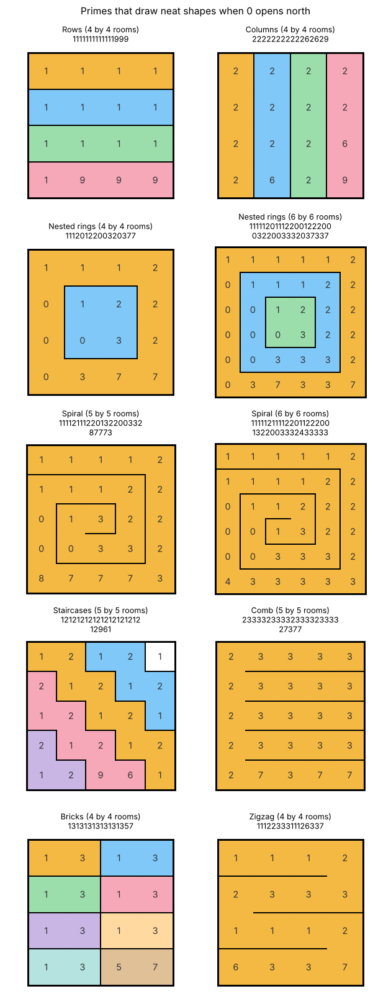

# Neat shapes: the smallest primes that draw rows and rings and spirals on door grids

> **About this page:** One AI model (Claude) wrote this page on 25 November 2026. The author of this repository asked for the experiments and the chatbot wrote the programs and ran the counts. The programs are neat_shapes.py and grid_tools.py in the folder boring-things/research-program-files/prime-mazes-scripts. The page proves nothing about primes. No other person has reviewed the page yet.

## The rule

Each room reads one number and opens one door: 0 and 4 and 8 open north. 1 and 5 and 9 open east. 2 and 6 open south. 3 and 7 open west. The numbers fill a square grid row by row starting at the top left room.

## How the primes were found

The chatbot chose a door for every room so that the open doors draw a shape. Each door can be written with two or three different digits so the program tried the digit choices from smallest to largest until the whole number was prime. So each number below is the smallest prime that draws its shape on its grid. These shapes were built on purpose and did not show up by chance.

To try a number open the program [maze-animation.html](maze-animation.html) and set the box named "Where the numbers are taken from" to "My own number or digits" and paste the number and press Finish.

## Rows (every room opens east)

Each row becomes its own hallway so the grid looks like stacked stripes.

- 2 by 2 rooms: 1151 (regions 2 and largest region 2 and longest walk 2)
- 3 by 3 rooms: 111111199 (regions 3 and largest region 3 and longest walk 3)
- 4 by 4 rooms: 1111111111111999 (regions 4 and largest region 4 and longest walk 4)
- 5 by 5 rooms: 1111111111111111111115591 (regions 5 and largest region 5 and longest walk 5)
- 6 by 6 rooms: 111111111111111111111111111111159559 (regions 6 and largest region 6 and longest walk 6)

## Columns (every room opens south and the last room opens east)

The stripes stand upright because every door opens downward. The last room opens east because a prime cannot end in an even digit.

- 2 by 2 rooms: 2221 (regions 2 and largest region 2 and longest walk 2)
- 3 by 3 rooms: 222226229 (regions 3 and largest region 3 and longest walk 3)
- 4 by 4 rooms: 2222222222262629 (regions 4 and largest region 4 and longest walk 4)
- 5 by 5 rooms: 2222222222222222222226221 (regions 5 and largest region 5 and longest walk 5)
- 6 by 6 rooms: 222222222222222222222222222222226669 (regions 6 and largest region 6 and longest walk 6)

## Nested rings (each layer of rooms is a clockwise loop)

Each layer of rooms is a loop. The 4 by 4 number draws a ring of 12 rooms around a separate block of 4 rooms and the 6 by 6 number draws three separate rings.

- 2 by 2 rooms: 1283 (regions 1 and largest region 4 and longest walk 4)
- 3 by 3 rooms: 112006073 (regions 1 and largest region 9 and longest walk 9)
- 4 by 4 rooms: 1112012200320377 (regions 2 and largest region 12 and longest walk 12)
- 5 by 5 rooms: 1111201122000220033243337 (regions 2 and largest region 16 and longest walk 16)
- 6 by 6 rooms: 111112011122001222000322003332037337 (regions 3 and largest region 20 and longest walk 20)

## Spiral (one hallway that winds into the center)

Every room is on one hallway that winds into the center so each of these primes earns the highest three part score for its grid.

- 2 by 2 rooms: 1213 (regions 1 and largest region 4 and longest walk 4)
- 3 by 3 rooms: 112132073 (regions 1 and largest region 9 and longest walk 9)
- 4 by 4 rooms: 1112112201724333 (regions 1 and largest region 16 and longest walk 16)
- 5 by 5 rooms: 1111211122013220033287773 (regions 1 and largest region 25 and longest walk 25)
- 6 by 6 rooms: 111112111122011222001322003332433333 (regions 1 and largest region 36 and longest walk 36)

## Staircases (east then south then east then south)

The regions run diagonally down the grid in steps.

- 2 by 2 rooms: 1229 (regions 2 and largest region 3 and longest walk 3)
- 3 by 3 rooms: 121212521 (regions 3 and largest region 5 and longest walk 5)
- 4 by 4 rooms: 1212212112126529 (regions 4 and largest region 7 and longest walk 7)
- 5 by 5 rooms: 1212121212121212121212961 (regions 5 and largest region 9 and longest walk 9)
- 6 by 6 rooms: 121212212121121212212121121212252169 (regions 6 and largest region 11 and longest walk 11)

## Comb (left column opens south and every other room opens west)

One spine runs down the left side with a tooth for every row.

- 2 by 2 rooms: 2767 (regions 1 and largest region 4 and longest walk 4)
- 3 by 3 rooms: 233233673 (regions 1 and largest region 9 and longest walk 7)
- 4 by 4 rooms: 2333233323336373 (regions 1 and largest region 16 and longest walk 10)
- 5 by 5 rooms: 2333323333233332333327377 (regions 1 and largest region 25 and longest walk 13)
- 6 by 6 rooms: 233333233333233333233333233333277737 (regions 1 and largest region 36 and longest walk 16)

## Bricks (pairs of rooms that open toward each other)

Every region is exactly 2 rooms.

- 2 by 2 rooms: 1753 (regions 2 and largest region 2 and longest walk 2)
- 4 by 4 rooms: 1313131313131357 (regions 8 and largest region 2 and longest walk 2)
- 6 by 6 rooms: 131313131313131313131313131313131393 (regions 18 and largest region 2 and longest walk 2)

## Zigzag (rows open east then west in turn and the row ends open south)

One hallway snakes back and forth through every room.

- 2 by 2 rooms: 1223 (regions 1 and largest region 4 and longest walk 4)
- 4 by 4 rooms: 1112233311126337 (regions 1 and largest region 16 and longest walk 16)
- 6 by 6 rooms: 111112233333111112233333111112233733 (regions 1 and largest region 36 and longest walk 36)

## Three things the search turned up

- **A ring made from a prime can turn clockwise and cannot turn counterclockwise.** A counterclockwise ring needs the bottom right room to open north and north takes an even digit. A prime with more than one digit never ends in an even digit.
- **The zigzag prime exists on grids with an even number of rooms along one side.** On a grid of 3 by 3 or 5 by 5 rooms the snake needs the last room to open south which again takes an even digit.
- **The digits themselves look patterned.** The rows prime is almost all 1s and the columns prime is almost all 2s and the spiral and ring primes repeat short runs of 1 and 2 and 0 and 3.

## Weak points

- Eight shapes were tried and many other shapes are possible.
- Each prime passed 30 rounds of a random-witness primality check which leaves a tiny chance of error for the largest numbers.
