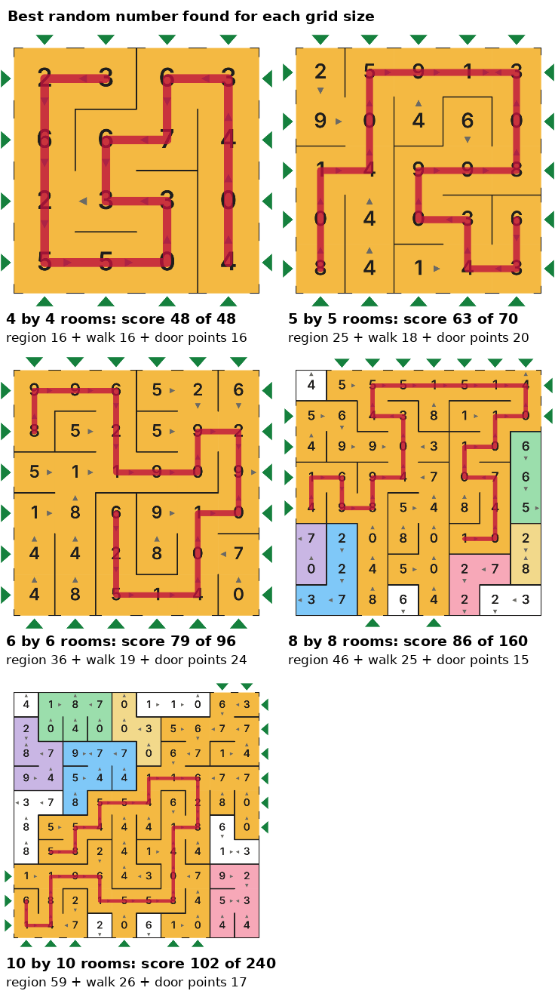
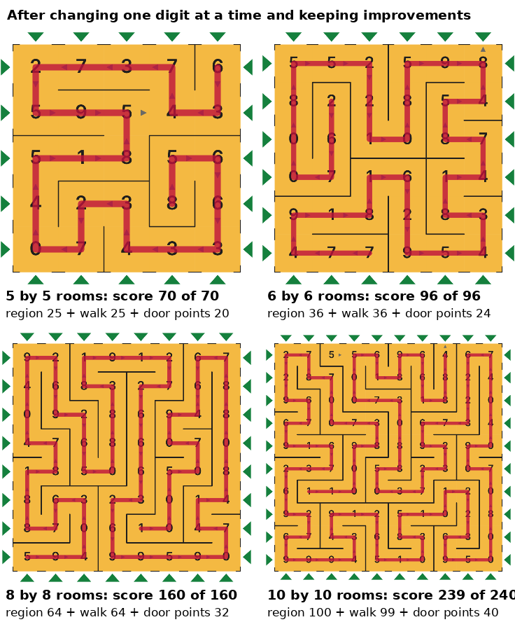

# Random number search: the highest scoring random numbers on door grids

> **About this page:** One AI model (Claude) wrote this page on 25 November 2026. The author of this repository asked for the experiments and the chatbot wrote the programs and ran the counts. The programs are random_search.py and random_search_strict_doors.py in the folder boring-things/research-program-files/prime-mazes-scripts. The page proves nothing about primes. No other person has reviewed the page yet.

## The rule and the score

Each room reads one number and opens one door: 0 and 4 and 8 open north. 1 and 5 and 9 open east. 2 and 6 open south. 3 and 7 open west. The numbers fill a square grid row by row starting at the top left room.

The three part score adds the largest region (the most rooms joined by open doors) and the longest walk (the most rooms one line can pass through without entering a room twice) and the door points. Every room on the edge of the grid is assumed to have a door to the outside that a player can open and a corner room has two. The player earns 1 door point for each outside door where the player can enter and walk through joined rooms to the opposite side of the grid.

The highest possible score on a grid with k rooms along one side is k times k for the region plus k times k for the walk plus 4 times k for the door points. The numbers on this page are random digits and are not primes.

## Experiment 1: try many random numbers and keep the best

- **4 by 4 rooms (200000 random numbers):** 2363667423305504 scored 48 of 48 (largest region 16 + longest walk 16 + door points 16).
- **5 by 5 rooms (150000 random numbers):** 2591390460149980403684143 scored 63 of 70 (largest region 25 + longest walk 18 + door points 20).
- **6 by 6 rooms (80000 random numbers):** 996526852592511909186910442807485140 scored 79 of 96 (largest region 36 + longest walk 19 + door points 24).
- **8 by 8 rooms (25000 random numbers):** 4555151456438110499031061694707649854845720801020245027837864223 scored 86 of 160 (largest region 46 + longest walk 25 + door points 15).
- **10 by 10 rooms (10000 random numbers):** 4187011063204003567787977067149454411677378554628085544418608582414413119643079268215584531472061044 scored 102 of 240 (largest region 59 + longest walk 26 + door points 17).

The best random number reached the highest possible score on the grid of 4 by 4 rooms and that number appeared on try number 37697. Luck falls behind as the grid grows: the best random number earned 100% of the possible score on 4 by 4 rooms and 90% on 5 by 5 rooms and 82% on 6 by 6 rooms and 54% on 8 by 8 rooms and 43% on 10 by 10 rooms.

## Experiment 2: change one digit at a time and keep any change that does not lower the score

The program started from each best random number and tried up to 40000 changes of a single digit.

- **5 by 5 rooms:** 2737659543518564238607433 scored 70 of 70 after 7 improving steps.
- **6 by 6 rooms:** 552598822854061087071614918283477954 scored 96 of 96 after 12 improving steps.
- **8 by 8 rooms:** 9219126746832768092869484768607018506508863230148706104759499590 scored 160 of 160 after 36 improving steps.
- **10 by 10 rooms:** 2755696467287018682496007318206707306734916988929023705823076110037120929125102867436836309994510950 scored 239 of 240 after 65 improving steps.

Small repeated improvements beat luck by a wide margin on large grids. The number for 8 by 8 rooms went from 86 to the highest possible 160. The number for 10 by 10 rooms stopped at 239 of 240 in this run with all 100 rooms joined and a longest walk of 99 rooms.

## High scoring numbers for grids of 10 by 10 rooms and 12 by 12 rooms

- **Spiral on 10 by 10 rooms:** score 240 of 240 (largest region 100 + longest walk 100 + door points 40). The number is 1111111112111111112201111112220011112222000112222200001322220000333222000333332200333333320333333333
- **Zigzag on 10 by 10 rooms:** score 240 of 240 (largest region 100 + longest walk 100 + door points 40). The number is 1111111112233333333311111111122333333333111111111223333333331111111112233333333311111111122333333333
- **Random number improved by single digit changes on 10 by 10 rooms:** score 240 of 240 (largest region 100 + longest walk 100 + door points 40). The number is 2771772777258490212852584758286303342330996904925827709463836990433960569169546067072472745514914118
- **Spiral on 12 by 12 rooms:** score 336 of 336 (largest region 144 + longest walk 144 + door points 48). The number is 111111111112111111111122011111111222001111112222000111122222000011222222000001322222000003332222000033333222000333333322003333333332033333333333
- **Zigzag on 12 by 12 rooms:** score 336 of 336 (largest region 144 + longest walk 144 + door points 48). The number is 111111111112233333333333111111111112233333333333111111111112233333333333111111111112233333333333111111111112233333333333111111111112233333333333
- **Random number improved by single digit changes on 12 by 12 rooms:** score 335 of 336 (largest region 144 + longest walk 143 + door points 48). The number is 559251559192427387366733465916431216238367592906219859067633687511796296194833827586521654011623858108033656477763754223591825007316437770337773

The spiral and the zigzag are built shapes that reach the highest possible score on every grid size. A second run of single digit changes on the 10 by 10 number reached 240 of 240.

## A stricter door rule that was tried and set aside

The chatbot also tried counting a door point only when a number in a room opened a door onto the outside and a walk led from that door to another such door on the opposite side.

- With one number in each room no grid ever earned a door point. The program checked all 262144 door patterns on 3 by 3 rooms and every random number in a new search of 415000 numbers on five grid sizes.
- The reason is that a group of joined rooms needs all but one of its doors to hold the group together so at most one door in the group is left over to open onto the outside.
- With two numbers in each room the stricter rule works: 77% of 60000 random grids of 3 by 3 rooms earned at least one door point and 89% of 25000 random grids of 4 by 4 rooms did.
- The author then chose the rule on this page in which every edge room has an outside door.

## Weak points

- Each grid size had one run so another run would find different numbers.
- The method of single digit changes can stall just short of the highest score.
- The numbers are random digits so nothing on this page is a statement about primes.
