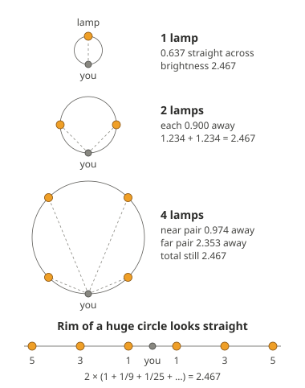

# Questions about lamps and the 60.79% and why base e keeps showing up

> **About this page:** One AI model (Claude) wrote this page on 22 November 2026 from a back and forth chat with the author of this repository. The questions are the author's questions with the wording tidied and the answers are the chatbot's answers shortened. The page continues the six earlier question pages in this folder (the last one is [coin-flip-questions.md](coin-flip-questions.md)). The facts are standard mathematics that a search will turn up so the page claims no new result. The value of the page is the plain-language route and the lamp drawing and the numbered list of numbers that keep reappearing. A program rechecked every figure (the file lamp_questions_check.py in the folder boring-things/research-program-files/prime-richness-scripts) and no other person has reviewed the page yet.

## Question: which numbers count toward the 60.79%?

A number counts when every prime in its breakdown appears only once. 2 × 3 × 5 × 7 = 210 counts. 2 × 2 × 3 × 3 = 36 does not count because 2 and 3 each appear twice. 12 = 2 × 2 × 3 does not count because one repeated prime is enough. A prime counts because a prime is a single piece used once.

A quick test: a number is left out exactly when the number divides evenly by some prime times itself (4 or 9 or 25 or 49 and so on).

## Question: where does pi × pi divided by 6 come from and how does that relate to the 60.79%? (A route with no primes.)

Any whole number splits in exactly one way into a perfect square times a number with no repeated prime piece. 12 is 4 × 3. 72 is 36 × 2. 50 is 25 × 2. 30 is 1 × 30. 16 is 16 × 1.

Sort all numbers by which square was pulled out. The numbers with square 1 are the no-repeat numbers. The numbers with square 4 are the no-repeat numbers stretched 4 times further apart so that group is one quarter as dense. Square 9 gives one ninth and square 16 gives one sixteenth. The groups cover every number once. So if the no-repeat numbers are a share c of all numbers then c × (1 + 1/4 + 1/9 + 1/16 + …) = 1 and c is 1 divided by 1.645 = 60.79%.

A check with the numbers up to 100: 61 have square 1 and 16 have square 4 and 8 have square 9 and 5 have square 16 and 3 have square 25 and 2 have square 36 and 2 have square 49 and 1 each have squares 64 and 81 and 100. The total is 100.

**The same argument in an orchard.** Stand at one corner of an orchard planted in a square grid. A tree is hidden when another tree sits on the straight line to that tree which happens when the row number and the column number share a prime piece. Every tree is a visible tree pushed 1 or 2 or 3 times further out and pushing a pattern k times further out in two directions makes the pattern k × k times thinner. So the share of visible trees is also 60.79%. In a 10 by 10 patch 63 of 100 trees are visible. In a 100 by 100 patch 6087 of 10000 are visible. In a 1000 by 1000 patch 608383 of one million are visible.

The pi arrives only at the step of adding 1 + 1/4 + 1/9 + … which is the lamp problem below.

## Question: is 3/4 × 8/9 × … like (1 − 1/n) multiplied n times with the squares as n?

Yes in part. Each factor is a shrinking chunk of the form (1 − 1/n) with n set to a prime squared: 3/4 is 1 − 1/4 and 8/9 is 1 − 1/9 and 24/25 is 1 − 1/25. In "(1 − 1/n) multiplied n times" the same factor is used n times which piles up to one full division by e. Here each factor is used once so each one is a slice of a division by e and the slices are 1/4 and 1/9 and 1/25 and 1/49.

Only prime squares appear because a number divisible by 16 is already divisible by 4.

Multiplying (1 − 1/4) × (1 − 1/9) × (1 − 1/16) × (1 − 1/25) through every square gives 3/4 then 2/3 then 5/8 then 3/5 and settles at exactly 1/2 by the telescoping trick. Restricting to prime squares is what brings in pi × pi.

Each factor splits in two: 3/4 is 1/2 × 3/2 and 8/9 is 2/3 × 4/3. The first part is the ordinary sieve factor (1 − 1/p) and the second part is the matching growth factor (1 + 1/p).

## Question: how do 63.6% and 60.79% compare?

- 63.6% is the smooth estimate: add the slices 1/4 + 1/9 + 1/25 + … = 0.4522 and take 1/e raised to that pile.
- 60.79% is the true share: multiply the real chunks 3/4 × 8/9 × 24/25 × …
- 54.8% is plain subtraction (1 − 0.4522) which is too low because a number such as 36 gets removed twice.

The true share is 2.8 points below the smooth estimate (about 95.6% of the estimate). A shrinking chunk cuts deeper than its slice. The chunk 3/4 acts like a slice of 0.2877 where the announced slice was 0.25 (a miss of 0.0377). The chunk 8/9 misses by 0.0067 and 24/25 by 0.0008 and 48/49 by 0.0002. All the misses total 0.0455 so the real pile is 0.4977 and 1/e raised to 0.4977 is 60.79%. The prime 2 supplies about 83% of the gap.

## Question: can a drawing show the lamp idea and where pi × pi divided by 4 enters?

The gray dot is you and each amber dot is a lamp. The dashed lines are the straight-line distances. Brightness is 1 divided by the distance squared.

The top circle has a distance around of 2. Pi is "around divided by across" so the distance across is 2 divided by pi = 0.637. Brightness uses the distance twice so the brightness is 1 divided by (2/pi × 2/pi) which flips to pi × pi divided by 4 = 2.467.

Each stage draws a circle twice as big through your spot and trades every lamp for two lamps on the new circle. The trade uses a fact about triangles with a square corner: one lamp at the height of the triangle is exactly as bright as two lamps at the ends of the two short sides. So the total stays at 2.467 while the lamps spread out 2 apart along the rim.

The nearest lamps creep from 0.900 away to 0.974 away and head toward exactly 1. On a circle large enough to look straight the lamps sit at 1 and 3 and 5 and so on to each side and the total is still 2.467.

## Question: two lamps at 1 unit give a total of 2. Why can one lamp at half a unit not replace the pair?

That plan treats brightness as 1 divided by the distance. Brightness is 1 divided by the distance squared because light spreads over the surface of a sphere and that surface grows with the distance times the distance. A lamp at half a unit gives 1 / (0.5 × 0.5) = 4. To give 2 the lamp has to sit at 0.707 which is 1 divided by the square root of 2. The drawing shows the same rule: one lamp at 0.637 matched two lamps at 0.900 and 0.900 / 0.637 is 1.414.

## Question: what happens when the distance to a lamp is halved again and again?

- At 1 unit the brightness is 1.
- At 1/2 unit the brightness is 4.
- At 1/4 unit the brightness is 16.
- At 1/8 unit the brightness is 64.

Each halving multiplies the brightness by 4. Each doubling of the distance cuts the brightness to a quarter: 1/4 at 2 units and 1/16 at 4 units and 1/64 at 8 units.

## Question: is the sum 1/4 + 1/16 + 1/64 + … where the 4/3 comes from?

Yes. The sum 1/4 + 1/16 + 1/64 + 1/256 + … equals exactly 1/3. With a leading 1 the sum is 4/3.

Every whole number is an odd number doubled some number of times: 12 is 3 doubled twice and 40 is 5 doubled three times and 7 is 7 doubled zero times. The lamps at the odd spots 1 and 3 and 5 give 1.2337. The lamps at 2 and 6 and 10 are the odd lamps at double the distance so that group gives a quarter of 1.2337. The lamps at 4 and 12 and 20 give a sixteenth. Every lamp lands in one group. So the full brightness is 1.2337 × (1 + 1/4 + 1/16 + …) = 1.2337 × 4/3 = 1.6449.

## Question: is 2.467 twice 1.2337?

Yes. 2.4674 is the brightness of the odd lamps on both sides (pi × pi / 4) and 1.2337 is one side alone (pi × pi / 8). The two sides are identical so one side is half.

## Question: could one lamp replace the whole endless row?

Yes in two ways.

- Keep the lamp at 1 unit and make the bulb 2.4674 times as strong as an ordinary bulb.
- Keep an ordinary bulb and pull the lamp in to 0.6366 units because 1 / (0.6366 × 0.6366) is 2.4674.

0.6366 is 2 divided by pi which is the distance of the single lamp at the top of the drawing. The calculation runs the lamp story backwards. The square root of 2.4674 is 1.5708 = pi divided by 2 so "2.4674 times as bright" and "1.5708 times closer" are the same statement.

## Question: what about a lamp at every prime?

A lamp at every prime on one side gives 1/4 + 1/9 + 1/25 + 1/49 + … = 0.4522.

- The lamp at 2 gives 0.25 which is about 55% of the total.
- Adding the lamp at 3 gives 0.3611 and the lamp at 5 gives 0.4011 and the lamp at 7 gives 0.4215.
- Every prime lamp beyond 7 adds 0.031 in all.

One ordinary lamp matches the prime row at 1.487 units. With prime lamps on both sides the total is 0.9045 and the matching distance is 1.051.

- Lamps at every whole number give 1.6449 and match one lamp at 0.780.
- Lamps at every whole number from 2 upward give 0.6449 and match one lamp at 1.245.
- Lamps at the primes give 0.4522 and match one lamp at 1.487.

The prime lamps supply about 70% of the light from all lamps from 2 upward. No tidy formula with pi is known for 0.4522. Lamps whose brightness fades only as 1 over the distance would give the sum of 1 over each prime which grows without limit so no single lamp could match those.

## Question: why does 63.6% show up in the prime lamp picture?

The brightness of the lamp at a prime p is 1 over p squared and the share of numbers that divide evenly by p squared is that same fraction. So the total brightness of the prime lamps (0.4522) is also the pile of knock-out shares in the square sieve. Reading that pile as divisions by e gives 63.6% and correcting each chunk gives the true 60.79%. In the lamp picture the square is there because light spreads over a sphere. In the sieve the square is there because a repeated prime piece means divisibility by a prime times itself.

## Question: is base e some kind of most balanced base in relation to the primes?

Three layers.

**Layer 1: the e in "1/e raised to 0.4522" is a unit of measure.** The same 63.6% can be written in base 2 as 1/2 raised to the power 0.6524 (0.4522 divided by 0.693). Base e is the base where "a shrink of size a" and "a power of size a" match one for one.

**Layer 2: a base e fact about the primes.** Multiply every prime up to x and ask what single number multiplied by itself x times gives that product. For the primes up to 1009 the answer is 2.60. For the primes up to one million the answer is 2.714. The answer heads to e. So the primes contribute one factor of e per whole number on average which is the same fact as "primes show up at the rate 1 divided by the natural logarithm". In base 10 the primes would weigh 0.434 per number.

**Layer 3: e as a balanced base in general.** Break a number into equal parts and multiply the parts. The product is largest when each part is about e. Splitting 10 into 3 parts gives 37.0 and into 4 parts of 2.5 gives 39.1 and into 5 parts of 2 gives 32.

## Question: what are examples where base e is simpler than base 10 or base 2?

1. A growth of 1% is the factor 1.01. The power is 0.00995 in base e and 0.00432 in base 10 and 0.01436 in base 2.
2. The square sieve estimate is 1/e to the power 0.4522 or 1/10 to the power 0.1964 or 1/2 to the power 0.6524.
3. The chance that a 100 digit number is prime is 1 / 230 in base e. In base 10 the logarithm is 100 so the chance is 1 / (2.3026 × 100). In base 2 the logarithm is 332 so the chance is 1 / (0.693 × 332).
4. With 2 events expected the chance of none is 1/e to the power 2 = 13.5%. That is 1/10 to the power 0.8686 or 1/2 to the power 2.885.
5. With an average wait of 10 minutes the chance of still waiting after t minutes is 1/e to the power (t / 10). In base 2 a half-life of 6.93 minutes has to be worked out first.
6. Money growing smoothly at 5% a year for 10 years grows by e to the power 0.5 = 1.649. In base 10 the power is 0.2171.
7. A quantity equal to e to the power t grows at a speed equal to its own size. For 10 to the power t the speed is 2.3026 times the size and for 2 to the power t the speed is 0.693 times the size.

The conversion factors are 2.3026 and 0.4343 (for base 10) and 0.693 and 1.4427 (for base 2). Base e is the base where the factor is 1. Base 10 matches written digits and base 2 matches yes-or-no questions.

## A numbered list of the numbers that keep reappearing

**The lamp family**

1. 0.6366 is 2 divided by pi which is the distance to the single lamp across the first small circle.
2. 2.4674 is pi × pi / 4 which is the brightness of that lamp and of the odd lamps on both sides.
3. 1.2337 is pi × pi / 8 which is half of 2.4674.
4. 4/3 is 1 + 1/4 + 1/16 + … which puts the even lamps back.
5. 1.6449 is pi × pi / 6 which is 1.2337 × 4/3 and is the brightness of a lamp at every whole number.
6. 0.6449 is 1.6449 minus 1 which is the lamps from 2 upward.
7. 0.4522 is the brightness of a lamp at every prime (1/4 + 1/9 + 1/25 + …).
8. 0.780 and 1.245 and 1.487 are the distances where one lamp matches rows 5 and 6 and 7.

**The square sieve family**

9. 60.79% is 6 / (pi × pi) which is 1 / 1.6449 and is the share of numbers with no repeated prime piece.
10. 63.6% is 1/e to the power 0.4522 which is the smooth estimate of 60.79%.
11. 54.8% is 1 minus 0.4522 which is the estimate that double counts overlaps.
12. 0.0455 is the total chunk miss that brings 63.6% down to 60.79%.

**The e family**

13. 2.718 is e and 0.3679 is 1 / e.
14. 0.6065 is half a division by e and the bell curve height at one typical wobble.
15. 0.693 is the natural logarithm of 2.
16. 2.3026 is the natural logarithm of 10.
17. 0.5820 is 1/e + 1/e² + 1/e³ + … which breaks apart as 1 − 1/2 + 1/12 − 1/720 and so on.

**The neighbors near 0.56 to 0.58**

18. 0.5615 is the sieve constant which is 1/e to the power 0.5772.
19. 0.5642 is 1 divided by the square root of pi.
20. 0.5671 is the Omega constant which equals 1/e raised to itself.
21. 0.5724 is half the natural logarithm of pi.
22. 0.5772 is the gap between 1 + 1/2 + 1/3 + … and the natural logarithm.
23. 0.5774 is 1 divided by the square root of 3 (a neighbor with no known link).

**The prime sum family**

24. 0.2615 is the gap between the sum of 1 over each prime and the double logarithm which equals 0.5772 minus 0.3157.
25. 0.3157 is the total chunk miss of the ordinary sieve.
26. 1.123 is 2 × 0.5615 which is the 12.3% overshoot of the sieve estimate.
27. 1.78 is 1 / 0.5615 which is the gain from blocking small primes.

**The leftover constants and pi**

28. −1/2 and −1/12 and 1/120 are the leftovers under 1 + 1 + 1 and 1 + 2 + 3 and the sum of cubes.
29. 12 is 2 × pi × pi / 1.6449 which ties −1/12 to row 5.
30. 6.283 is 2 × pi (the lap length of sideways growth) and 39.48 is that number squared.

**The critical line family**

31. 1/2 is the dial setting which means square root sized ripples.
32. 14.13 and 21.02 and 25.01 are the first three pitches.
33. −1.4604 is the leftover constant at the dial setting 1/2.

**The stick family**

34. 62.4% and 21% are the average shares of a number held by its largest and second largest prime piece.
35. 69.3% is the share of numbers with a prime piece above their square root which is row 15 again.
